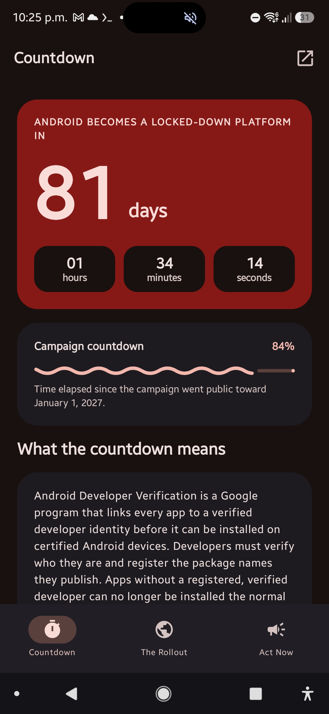
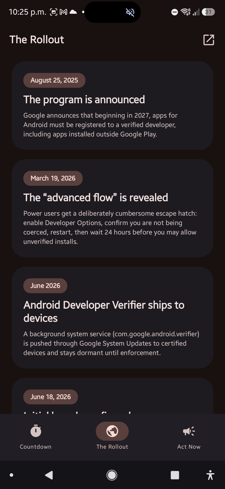
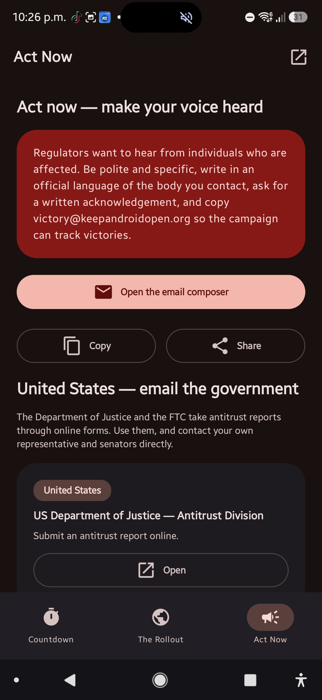

# Keep Android Open — Android app

**A native Material 3 Expressive app for the [Keep Android Open](https://keepandroidopen.org) campaign** — a live countdown to the January 1, 2027 Android lockdown, a clear explainer of Google's Android Developer Verification rollout, and one-tap "Act Now" tools to contact your representatives and regulators.

[](LICENSE)
[](#requirements)
[](../../releases/latest)
[](../../actions/workflows/build.yml)
[](../../stargazers)
[](#contributing)

  

## Why this exists

Google is introducing **Android Developer Verification** — every app must be tied to a centrally verified developer before it can be installed on certified Android devices. Enforcement starts **September 30, 2026** in Brazil, Indonesia, Singapore and Thailand, and expands globally in **2027**. This app exists to make that deadline impossible to ignore, explain exactly what's at stake, and give you a fast way to push back.

## Features

- **Live countdown** — days / hours / minutes / seconds to `2027-01-01 00:00` local time, matching the banner on keepandroidopen.org, with an expressive wavy progress indicator.
- **The Rollout** — what Developer Verification is, the full timeline, the three verification paths, and why the "advanced flow" is not a real solution.
- **Act Now** — a pre-written letter you can email, copy or share, plus DOJ and FTC antitrust forms and competition/consumer regulators worldwide.
- **Material 3 Expressive** — `MaterialExpressiveTheme`, `MotionScheme.expressive()`, and the expressive shape scale.
- **No ads. No trackers. No proprietary dependencies.** The app makes no network requests; it only opens links in your browser.

## Install

**Option A — direct download (recommended):**
1. Grab the latest APK from the [Releases page](../../releases/latest).
2. Open the file and allow install from unknown sources when prompted.

```
app-release.apk
SHA-256: 9d79fc4a745bedcc03d43277a54f224570dc331701dc41e342e9431d2b7b9281
Signing cert SHA-256: 6cf19d723eaa965e339a91d2d33f5b73b38469e19d48d9dd3c6f46bbd33cc96a
```

**Option B — [Obtainium](https://github.com/ImranR98/Obtainium)** (auto-updates straight from GitHub):

```
https://github.com/tsunderswapElnina/Keep-Android-Open-UI
```

**Option C — app stores:** inclusion requested on IzzyOnDroid and proposed for F-Droid. Badges land here once approved.

## Requirements

Android 7.0+. Built with Kotlin and Jetpack Compose.

| | |
|---|---|
| Kotlin / AGP / Gradle | 2.4.21 (AGP built-in) / 9.1.0 / 9.8.1 |
| Compose / Material 3 | BOM 2026.09.00 / material3 1.5.0-beta01 |
| compileSdk / targetSdk / minSdk | 37 / 36 / 24 |

## Build

```sh
./gradlew :app:assembleDebug      # APK → app/build/outputs/apk/debug/
./gradlew :app:testDebugUnitTest  # countdown unit tests
```

You need the Android SDK with platform 37. Set `ANDROID_HOME`, or write `sdk.dir=/path` to `local.properties`.

### Building on-device in Termux

This project was built end-to-end inside Termux with no PC. See the notes in the commit history for the tweaks (Maven mirror, native `aapt2`, wrapper seeding) that make that work.

## Project layout

```
app/src/main/java/org/keepandroidopen/app/
├── MainActivity.kt
├── data/Countdown.kt        # target date + pure countdown math
├── data/Content.kt          # timeline, paths, contacts, letter template
├── ui/KeepAndroidOpenApp.kt # scaffolds + bottom navigation
├── ui/screens/              # CountdownScreen, RolloutScreen, ActNowScreen
├── ui/theme/                # Material 3 Expressive theme
└── util/Intents.kt          # email / share / clipboard / open-url
```

F-Droid build recipe: [`metadata/org.keepandroidopen.app.yml`](metadata/org.keepandroidopen.app.yml).

## Contributing

Issues and pull requests are welcome. Ideas that would help most:

- Translations (strings live in `app/src/main/res/values/`)
- Verified regulator/representative contact details for more countries
- Accessibility and small-screen polish
- Reproducible-build support for F-Droid

If this is useful to you, **a star helps other people find it** — and sharing it with your representative is even better.

## License

MIT — see [LICENSE](LICENSE). Part of the campaign at [keepandroidopen.org](https://keepandroidopen.org).

## AI disclosure

This app was developed with the assistance of generative AI (an AI coding assistant wrote the large majority of the source). Some reviewers and app stores reject "vibe-coded" apps outright, so this may be refused inclusion there. It is published here in the spirit of full transparency about its provenance.
